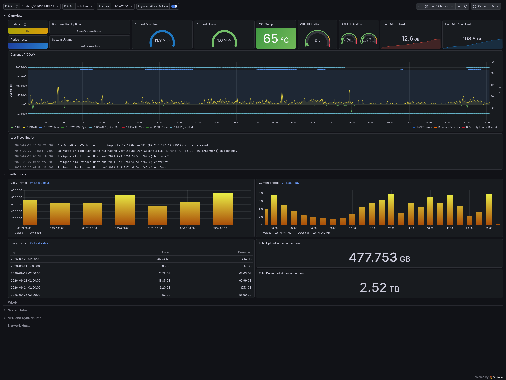

<p align="center">
  
</p>

<h1 align="center">fritzFluxDB</h1>

<p align="center">
  Lightweight daemon that collects metrics from your FRITZ!Box and pushes them into InfluxDB or QuestDB.
</p>

<p align="center">
  <a href="https://github.com/Gill-Bates/fritzfluxdb/releases">
    
  </a>
  <a href="https://github.com/Gill-Bates/fritzfluxdb/actions/workflows/ci.yml">
    
  </a>
  <a href="https://github.com/Gill-Bates/fritzfluxdb/actions/workflows/docker-build.yml">
    
  </a>
  <a href="https://hub.docker.com/r/giiibates/fritzfluxdb">
    
  </a>
  <a href="https://github.com/Gill-Bates/fritzfluxdb/blob/main/LICENSE">
    
  </a>
  <a href="https://hub.docker.com/r/giiibates/fritzfluxdb/tags">
    
  </a>
</p>

<p align="center">
  <a href="#quick-start"></a>
  <a href="https://gill-bates.github.io/fritzfluxdb/"></a>
</p>

## Features

| Area | Detail |
| --- | --- |
| Backends | InfluxDB v1, InfluxDB v2, QuestDB 10+ (recommended; optional server-side downsampling) |
| Data | TR-064 and Lua services, home automation, call list, router log, VPN, network hosts, system statistics |
| Container | Multi-arch (`amd64`/`arm64`), non-root, Tini as PID 1, restart watchdog, buffer flush on shutdown, `fritzflux-cli` for QuestDB checks and cleanup |
| Dashboards | System, call log and router log dashboards for every backend, plus home automation for InfluxDB v2 and QuestDB, in `utils/grafana/` |

<p align="center">
  
</p>

## Quick Start

> **Version 2.0.0 starts with fresh database schemas.** Use a new QuestDB instance, InfluxDB
> database or bucket; nothing is migrated and existing data is not touched. Home-automation devices
> are identified by their AIN in the `id` tag, and `name` stays a display tag.


```bash
test -e .env || cat .env.example .env.questdb.example > .env
# edit .env with your FRITZ!Box settings
docker compose -f docker/docker-compose.questdb.yml up -d
```

The Compose file starts QuestDB together with fritzfluxdb. For InfluxDB, build `.env` from
`.env.example` plus `.env.influxdb.example` and start `docker/docker-compose.influx2.yml` (or
`docker-compose.influx1.yml`); these files start fritzfluxdb only, so an existing InfluxDB must be
reachable from the container. For a local Python run, see
[Installation](https://gill-bates.github.io/fritzfluxdb/getting-started/installation/) and
[Docker Compose](https://gill-bates.github.io/fritzfluxdb/getting-started/docker/).

## Documentation

- [Installation](https://gill-bates.github.io/fritzfluxdb/getting-started/installation/)
- [Environment variables](https://gill-bates.github.io/fritzfluxdb/configuration/environment/)
- [Storage backends](https://gill-bates.github.io/fritzfluxdb/storage/overview/)
- [Grafana dashboards](https://gill-bates.github.io/fritzfluxdb/monitoring/grafana/)
- [Local development](https://gill-bates.github.io/fritzfluxdb/development/setup/)
- [Changelog](CHANGELOG.md)

## License

[MIT](LICENSE) — © 2026 Gill-Bates

---

> **Disclaimer:** This project is an independent open-source tool and is not affiliated with, endorsed by, or in any way associated with FRITZ.com GmbH, Alt-Moabit 95, 10559 Berlin, or the FRITZ!Box product line. FRITZ!Box is a registered trademark of FRITZ.com GmbH.

<p align="center">
  <a href="https://www.buymeacoffee.com/tnsteinerx">
    
  </a>
</p>