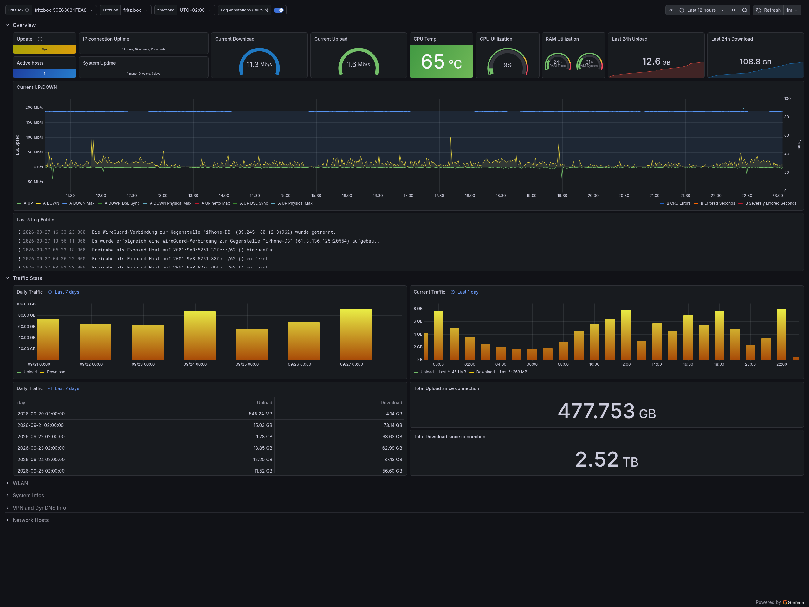

# fritzFluxDB

Lightweight daemon that collects metrics from your FRITZ!Box and pushes them into InfluxDB or QuestDB.

[](https://hub.docker.com/r/giiibates/fritzfluxdb)
[](https://hub.docker.com/r/giiibates/fritzfluxdb/tags)

[Full documentation](https://gill-bates.github.io/fritzfluxdb/)

## Features

| Area | Detail |
| --- | --- |
| Backends | InfluxDB v1, InfluxDB v2, QuestDB 10+ (recommended; optional server-side downsampling) |
| Data | TR-064 and Lua services, home automation, call list, router log, VPN, network hosts, system statistics |
| Container | Multi-arch (`amd64`/`arm64`), non-root, Tini as PID 1, restart watchdog, buffer flush on shutdown, `fritzflux-cli` for QuestDB checks and cleanup |
| Dashboards | System, call log and router log dashboards for every backend, plus home automation for InfluxDB v2 and QuestDB, in [`utils/grafana/`](https://github.com/Gill-Bates/fritzfluxdb/tree/main/utils/grafana) |



This fork runs on Python 3.13, uses `httpx` for database writes, and backs off exponentially
on HTTP errors. See the [comparison with the original](https://gill-bates.github.io/fritzfluxdb/development/fork-comparison/).

## Quick Start

The recommended setup uses QuestDB. Create a `.env` file:

```env
FRITZBOX_HOSTNAME=192.168.178.1
FRITZBOX_USERNAME=<fritzbox-user>
FRITZBOX_PASSWORD=<fritzbox-password>
```

Create `docker-compose.yml`:

```yaml
services:
  questdb:
    image: questdb/questdb:latest
    container_name: questdb
    restart: unless-stopped
    # No host ports: fritzfluxdb reaches QuestDB over the Compose network. QuestDB's HTTP/SQL
    # interface is unauthenticated by default; publish it only on loopback, e.g. "127.0.0.1:9000:9000".
    volumes:
      - questdb_data:/var/lib/questdb
    environment:
      - QDB_TELEMETRY_ENABLED=false

  fritzfluxdb:
    image: giiibates/fritzfluxdb:latest
    container_name: fritzfluxdb
    restart: unless-stopped
    stop_grace_period: 40s
    depends_on:
      - questdb
    env_file:
      - ./.env
    environment:
      TZ: Europe/Berlin
      LOG_LEVEL: INFO
      DB_TYPE: questdb
      QUESTDB_HOSTNAME: questdb
      QUESTDB_PORT: 9000
      QUESTDB_ALLOW_PLAINTEXT_CREDENTIALS: "true"
    security_opt:
      - no-new-privileges:true
    cap_drop:
      - ALL
    # The daemon only writes its PID file to /tmp.
    read_only: true
    tmpfs:
      - /tmp
    healthcheck:
      test: ["CMD-SHELL", "kill -0 \"$$(cat /tmp/fritzfluxdb.pid 2>/dev/null)\" 2>/dev/null || exit 1"]
      interval: 30s
      timeout: 10s
      retries: 3
      start_period: 15s

volumes:
  questdb_data:
```

Start it:

```bash
docker compose up -d
```

> **Version 2.0.0 starts with fresh database schemas.** Use a new QuestDB instance, InfluxDB
> database or bucket; nothing is migrated and existing data is not touched. Home-automation devices
> are identified by their AIN in the `id` tag, and `name` stays a display tag.

The Compose file starts QuestDB together with fritzfluxdb. For InfluxDB, omit the `questdb` service
and set `DB_TYPE=influxdb_v2` (or `influxdb_v1`) plus the `INFLUXDB_*` settings; an existing InfluxDB
must be reachable from the container. See
[Installation](https://gill-bates.github.io/fritzfluxdb/getting-started/installation/) and
[Docker Compose](https://gill-bates.github.io/fritzfluxdb/getting-started/docker/).

## Documentation

- [Installation](https://gill-bates.github.io/fritzfluxdb/getting-started/installation/)
- [Environment variables](https://gill-bates.github.io/fritzfluxdb/configuration/environment/)
- [Storage backends](https://gill-bates.github.io/fritzfluxdb/storage/overview/)
- [Grafana dashboards](https://gill-bates.github.io/fritzfluxdb/monitoring/grafana/)
- [Local development](https://gill-bates.github.io/fritzfluxdb/development/setup/)
- [Changelog](https://github.com/Gill-Bates/fritzfluxdb/blob/main/CHANGELOG.md)

## License

[MIT](https://github.com/Gill-Bates/fritzfluxdb/blob/main/LICENSE) — © 2026 Gill-Bates

---

> This project is not affiliated with or endorsed by FRITZ.com GmbH, Alt-Moabit 95, 10559 Berlin. FRITZ!Box is a registered trademark of FRITZ.com GmbH.

[](https://www.buymeacoffee.com/tnsteinerx)
