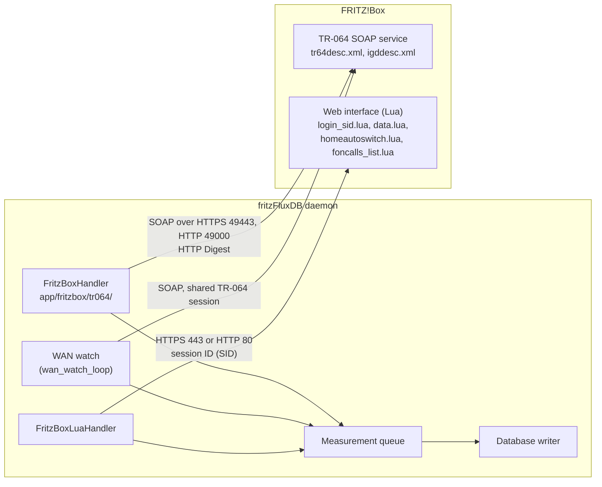

# Architecture

fritzFluxDB is a Python 3.14 asynchronous daemon. The container image installs the `app` package
with pip and starts it with `python -m app.main`.

```text
app/main.py
    ├── FritzBoxHandler          TR-064 service polling
    ├── FritzBoxLuaHandler       Lua polling on FRITZ!OS 7+
    ├── InfluxLogAndConfigWriter log and configuration measurements
    └── InfluxHandler            InfluxDB v1/v2 or QuestDB writer
```

## FRITZ!Box interfaces

The daemon talks to the FRITZ!Box over two separate interfaces. They differ in protocol, port,
login, and code path and are never mixed: a service definition belongs to exactly one of them.



*Communication relationships inside the daemon and towards the FRITZ!Box. The table below lists the same two interfaces with their data.*

| Interface | Transport and port | Login | Data | Switch in the FRITZ!Box |
| --- | --- | --- | --- | --- |
| TR-064 (SOAP) | HTTPS `49443` or HTTP `49000`, detected automatically; `FRITZBOX_PORT` | HTTP Digest with the FRITZ!Box user | WAN and DSL status, device info, LAN and WLAN, remote access, MyFRITZ!, WAN interruption watch | **Allow access for applications**; if it is off, the daemon exits with `78` |
| Lua (web interface) | HTTPS `443` or HTTP `80` | Session ID from `login_sid.lua` | Smart home, call list, router log, VPN, network hosts, connection details, system and energy statistics | None; uses the normal web login |

TR-064 is the standard of the Broadband Forum (formerly DSL Forum) that AVM implements on the
FRITZ!Box. The daemon uses only TR-064, never TR-069 (CWMP): TR-069 is the protocol a provider uses
to manage the router remotely. The service definitions are in
`app/fritzbox/service_definitions/tr064.py` (TR-064) and in the other modules of that package
(Lua). Specification reference for the WAN PPP behavior:
[Polling and data model](../configuration/data-model.md#wan-interruption-causes).

## Repository layout

| Path | Responsibility |
| --- | --- |
| `app/fritzbox/` | FRITZ!Box connections, parsing, and service definitions. |
| `app/influxdb/` | Backend configuration, HTTP writes, buffering, retry, and retention handling. |
| `app/utils/` | Part of the `app` package: command-line parsing (`cli_parser`), configuration loading (`configparser`), validated configuration models (`settings`, pydantic), logging (`log`), version and build metadata (`version`), shared helpers (`common`), measurement primitives (`measurement`), and the `fritzflux-cli` QuestDB admin tool (`questdb_admin`). |
| `docker/entrypoint.sh` | Watchdog, restart backoff, signal forwarding, and exit handling. |
| `utils/` (repository root) | Not importable code: backend-specific Grafana dashboard JSON files (`utils/grafana/`) and the QuestDB server configuration example (`utils/questdb/`). |
| `tools/` | Scripts that run in CI and during development, such as the release, Trivy report, and failure-issue tools. See [Contributing](contributing.md#ci-workflows-and-scripts). |
| `.github/` | Workflows, the job setup helper, the release-notes script, and the Renovate and zizmor configuration. |
| `tests/` | pytest suite for the `app` package (configuration, FRITZ!Box handlers, storage, shutdown, `fritzflux-cli`) and for the scripts in `tools/` and `.github/scripts/`. |

## Runtime flow

At startup the daemon reads environment variables, parses optional INI configuration, validates all handlers, and
connects to the FRITZ!Box. Producers put measurements into an asyncio queue. The database writer
consumes that queue, batches writes, and applies retry/backoff rules. Shutdown cancels producers,
drains the queue, then closes the writer and FRITZ!Box connections.

WAN interruption classification is split into `app/fritzbox/wan_cause.py` (pure models and
rules), `wan_tracker.py` (state machine), and `wan_watch.py` (TR-064 polling). The handler runs
them in an extra producer task, `wan_watch_loop`. It uses the shared FRITZ!Box session read-only,
takes it once per cycle, and never logs in, reconnects, or closes it. Producers are cancelled and
drained before the connection closes.

TR-064 runs on a native client in `app/fritzbox/tr064/` (httpx, HTTP Digest, defusedxml for
all XML). It does not verify the FRITZ!Box certificate over HTTPS, because the box uses a
self-signed one; the `TR064_VERIFY_TLS` constant keeps that choice explicit in one place.
The serial number is used to derive the measurement/table name after the initial connection. This
is why dashboards must permit a configurable name.

## Compatibility and safety decisions

| Area | Decision and reason |
| --- | --- |
| TR-064 trust (D1) | Preserve automatic HTTPS detection and unverified private box certificates. `FRITZBOX_CA_FILE` applies to Lua only; extending trust verification to TR-064 requires a separate configuration and security change. |
| XML parsing (D10) | Use `defusedxml` with bounded size, depth and element counts. Reject DTDs, entities and unsafe discovery URLs, including unsafe entries in the optional IGD description. |
| Forced disconnection (D11) | A newly reported forced-disconnect code supports `planned_disconnect / probable`, also without DSL or a sampled down state. It does not identify the initiator; router restart and observed sync loss take precedence. |
| HTTP 403 | Treat it as a transient action failure. A forbidden action alone cannot establish that credentials changed, so it does not trigger a login or exit 78. |
| QuestDB cleanup | `fritzflux-cli` deletes only metrics tables with matching persisted ownership IDs. Events tables and custom fallback names remain outside its deletion scope; suffix similarity is not proof of ownership. |
| WAN history | Interruption fields retain the raw table's history window. They are not rollup aggregates; adding them to a fixed view schema or moving them to events would require a separate data-model change. |
| Persisted identities | Keep existing metric names, call-list hashes and legacy display sentinels. Home-automation AINs are the stable `id`; missing host identifiers retain `unknown`. Heating codes 253/254 remain raw values. A display name is not a new identity. |
| Lua hardening | Lua responses reuse the bounded XML parser and protocol-error type. This is shared input hardening; it does not route Lua calls through SOAP. |
| Shutdown | Bound in-flight requests, queue draining and final flushing separately. Python joins its worker threads normally. Every TR-064 and Lua request has an overall deadline of at most 10 s (`app/fritzbox/tr064/deadline.py`), which also stops a peer that sends data in tiny pieces; the watchdog remains the hard process deadline. Lost buffered measurements are logged. |

Transport and parser similarities do not imply identical policies: SOAP and Lua have different
authentication and return contracts, table TTL helpers have different ownership rules, and firmware
definitions can evolve independently. Their safety and compatibility tests define those boundaries.
