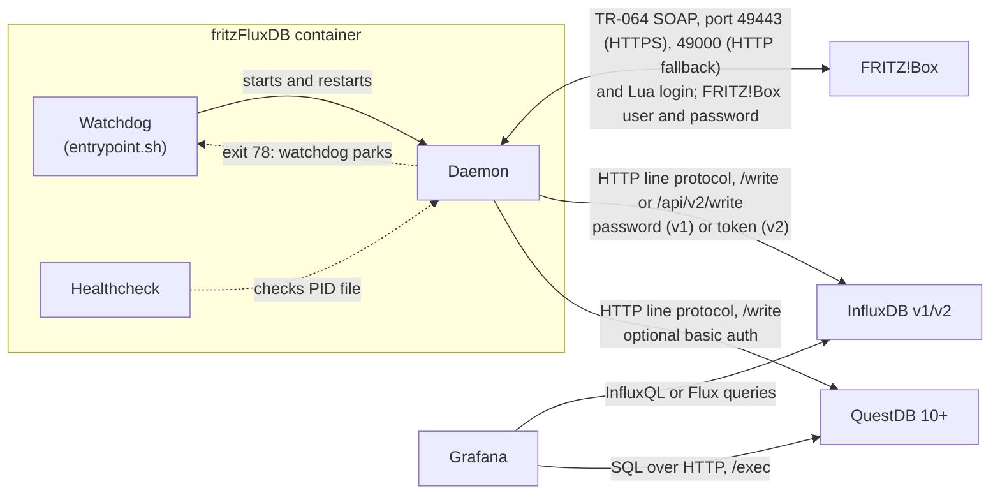

# fritzFluxDB

<p align="center">
  
</p>

fritzFluxDB is a lightweight, container-friendly daemon that collects metrics from a
FRITZ!Box and writes them to InfluxDB v1, InfluxDB v2, or QuestDB. It also exposes call logs,
router logs, VPN data, network hosts, connection information, system statistics, and supported
smart-home metrics to the selected time-series backend.

!!! tip "QuestDB is the recommended backend"
    InfluxDB v1 and v2 remain supported. See [Backend overview](storage/overview.md) for the reasons.

## Start here

The recommended deployment is Docker Compose with QuestDB. Create `.env` from the basic template
and the QuestDB template, then edit it with your FRITZ!Box values:

```bash
test -e .env || cat .env.example .env.questdb.example > .env
```

For InfluxDB, use `.env.influxdb.example` instead. Template and Compose file per backend are listed
in [Docker Compose](getting-started/docker.md); the backends are compared in
[Backend overview](storage/overview.md).

!!! warning "Credentials stay local"
    The examples in this documentation use placeholders only. Keep `.env`, tokens, passwords,
    and exported database credentials outside Git and never paste them into issue reports.

## What the daemon does



*Communication paths: the daemon polls the FRITZ!Box and writes to InfluxDB or QuestDB; Grafana reads from the backend. The watchdog restarts the daemon on failures but parks on exit status 78 (see [Watchdog](configuration/watchdog.md)).*

The daemon polls the FRITZ!Box asynchronously, buffers measurements, and flushes them before a
graceful shutdown when possible. The image runs as a non-root user with Tini and a
[watchdog](configuration/watchdog.md).

## Documentation map

| Page | Content |
| --- | --- |
| [Installation](getting-started/installation.md) | Prerequisites and deployment choices |
| [Environment variables](configuration/environment.md) | Runtime configuration |
| [Polling and data model](configuration/data-model.md) | Collection cadence and measurement naming |
| [Docker watchdog](configuration/watchdog.md) | Restart behaviour and exit codes |
| [InfluxDB](storage/influxdb.md), [QuestDB](storage/questdb.md) | Backend-specific setup |
| [Grafana dashboards](monitoring/grafana.md) | Import and datasource requirements |
| [Troubleshooting](monitoring/troubleshooting.md) | Symptoms and fixes |
| [Architecture](development/architecture.md) | Code layout and runtime flow |

The [changelog](changelog.md) lists the released versions and their notes.
The project is independent open source software and is not affiliated with FRITZ.com GmbH, Alt-Moabit 95, 10559 Berlin.
